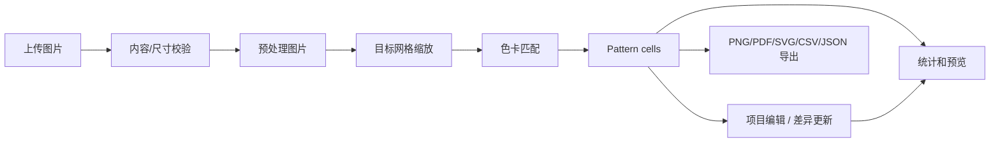

# 后端架构（0.3.0）

## 目标与边界

后端是拼豆图纸的唯一可信数据源：它负责校验原图、生成可复现的网格色号、计算统计、保存项目和产出打印文件；前端只负责编辑交互与预览。网格单元始终保存色卡 `code` 或 `null`，不保存仅供显示的 RGB 值。

0.3.0 使用 FastAPI、本地文件存储和 SQLite：图纸工程与二进制文件保留在数据卷，SQLite 保存账户、会话、资源归属与发布审核记录。它覆盖转换、差异编辑、PNG/PDF/SVG/CSV/JSON 导出、账户隔离、管理员用户管理和作品审核发布。PostgreSQL、Redis、Celery、邮件验证和对象存储保留为后续部署扩展，不应混入当前同步请求链路。

## 模块职责

| 层 | 位置 | 职责 |
| --- | --- | --- |
| HTTP | `backend/app/api/v1` | 解析请求、HTTP 状态码和统一响应包装，不包含图像/业务逻辑。 |
| Schema | `backend/app/schemas` | Pydantic 输入约束与枚举，防止非法网格、色号和导出选项进入服务层。 |
| Service | `backend/app/services` | 图像处理、色卡匹配、统计、项目与导出；可独立单元测试。 |
| Storage | `storage_service.py` | 生成不可猜测 ID、原子写 JSON、定位媒体文件；不使用客户端提供的路径。 |
| Auth | `auth_service.py` | SQLite 用户、scrypt 密码哈希、会话、角色与资源归属；管理员权限在服务端判断。 |
| Moderation | `publication_service.py` | 作品提交、审核队列、公开快照与审核记录。 |
| 静态数据 | `app/palettes/mard-291.json` | 默认 291 色 MARD 屏幕参考色卡；色卡服务展开系列并校验唯一色号。 |
| 预设 | `app/core/presets.py` | 手机挂件、钥匙扣、杯垫、相框等网格尺寸与迷你／中号豆物理尺寸。 |

## 核心数据

`Pattern` 是系统真值。它以一维数组保存单元格，索引为 `row * grid_width + column`：

```json
{
  "id": "pat_…",
  "revision": 3,
  "palette_id": "mard-291",
  "grid_width": 112,
  "grid_height": 84,
  "cells": ["A1", null, "B12"],
  "statistics": { "total_beads": 8126 }
}
```

`Project` 只引用图纸与编辑器设置；导出记录引用项目或图纸。项目复制会复制图纸与预览，因此编辑副本不会更改原项目。

本地存储布局：

```text
data/
├── perler-studio.db                 # 用户、会话、资源归属、发布审核
├── uploads/{image_id}/source.* + preview.png + metadata.json
├── patterns/{pattern_id}.json + {pattern_id}.png
├── projects/{project_id}.json
├── exports/{export_id}.{png,pdf,svg,csv,json} + {export_id}.json
├── versions/{project_id}/{version_id}.json
├── shares/{share_token}.json
└── tasks/{task_id}.json
```

JSON 使用临时文件后原子替换，避免进程中断生成半份工程文件。

## 请求流程



颜色匹配支持 RGB、CIE76、CIE94、CIEDE2000 与兼容旧项目的 `fidelity` 混合感知度量；新项目默认使用与质量报告相同的 CIEDE2000。默认 `adaptive` 网格采样在每格 3 × 3 子采样内：平滑区域使用 alpha 感知的线性光平均，真实轮廓则取代表色。自动选色把源网格汇总成带频次的颜色代表，逐步选择使平方 ΔE00 下降最多的真实品牌色号，并以 P95 ΔE00 目标决定是否提前停止。MARD 扩展／特殊材质色默认排除、可显式启用；透明像素以 `null` 保存，不参与材料统计。

默认 `medium` 清理使用确定性的边缘感知空间能量优化。数据项约束每格替换后的感知色差；相邻项只在源图相邻像素相似时惩罚色号跳变，权重会随源图 ΔE00 增大而快速衰减。算法先用红黑 ICM 更新相邻候选色，再对不超过 8 格的连通色岛进行原子区域提案，解决逐格更新的局部能量障碍。锁定色格不会被清理，透明格不参与优化；`light` 保留旧的单格保守清理，`off` 完全关闭后处理。

`structure_aware = true` 时，服务端在采样网格上生成归一化重点图。重点图融合局部 ΔE00 边缘、BoxBlur 多尺度对比、量化 LAB 色族稀有度、转换预设和创作者焦点。自动色卡选择对重点权重做非线性放大，让小面积五官、文字和轮廓能与大背景竞争色号；空间能量的数据项按重点权重缩放，并在重点边界降低相邻平滑惩罚。整体 P95 停止条件仍按未加权源像素计算，因此开启重点保护不会改变质量目标的定义。像素画预设强制绕过重点图，避免修改人工像素结构。

色卡颜色可以同时保存屏幕 `rgb` 和 D65/2° 实体 `measured_lab`。服务端在加载时建立逐色号 LAB 矩阵：实测值优先，缺失值按 sRGB 回退；同一矩阵贯穿色阶派生、质量驱动限色、单格匹配、空间优化、库存替代、色彩报告与热力图。色卡和图纸响应会分别暴露 `colorimetry_status`／`quality_basis` 及覆盖率，使部分校准不会被误报为完整实体校准。RGB 欧氏距离是显式兼容模式，仍只使用屏幕 RGB。

第五阶段将质量选色改为尾部重加权设施选址：以当前误差的 P90～P95 区间构造连续权重，并在 P95 以上提高惩罚，从而直接压低高色差尾部；随后最多执行两轮确定性调色板 1-swap，每个提案都会重新分配代表色标签，并要求 P95、总体目标和结构保护约束同时成立。报告另行使用全部当前合格色号计算逐格最近色的 Oracle 下界，用于区分调色板／限色算法损失与品牌色卡自身的色域上限。

## API 契约

全部业务接口位于 `/api/v1`，响应统一为：

```json
{ "success": true, "data": {}, "message": null, "code": null }
```

| 资源 | 接口范围 |
| --- | --- |
| 图片 | 上传、读取与生成预处理副本 |
| 图纸 | 图片预览/生成/原地重生成，空白/模板/文字创建，差异编辑，拼板与制作计划 |
| 项目 | 列表/分页/CRUD/复制，版本快照与恢复，客户分享 |
| 发布 | 提交审核、个人记录、继续编辑、公开列表与详情、收藏和再创作 |
| 账户 | 注册、登录、注销、资料与密码 |
| 管理 | 用户管理、审核详情、通过/驳回与下架 |
| 色卡 | 系统色卡读取和个人自定义色卡 CRUD |
| 预设 | 网格、图案模板和底板模板 |
| 导出 | PNG/PDF/SVG/CSV/JSON 创建、状态和下载 |
| 任务 | 为未来异步执行保留的任务读取契约 |

精确方法、路径、访问条件和参数边界集中维护在 [API 概览](api.md)，运行时 Schema 以 `/docs` 生成的 OpenAPI 为准。

`PUT /patterns/{id}` 接收一组单元格差异及可选 `base_revision`。服务端拒绝版本或 `before` 值不匹配的请求并返回 `409`，供前端自动保存时刷新/合并。

## 安全与限制

- 上传按实际图片内容验证，不信任扩展名或 MIME 声明；限制大小、边长和总像素。
- 文件以服务端 UUID 存储，媒体 URL 仅指向服务生成的相对路径。
- 密码采用 scrypt 哈希；会话令牌仅保存 SHA-256 摘要。用户、管理员与资源归属均在服务端检查，前端路由仅作为体验层保护。
- 管理员重置密码、停用或删除用户时，会注销目标用户的所有会话。删除采用匿名化停用，保留资源与审核关联，避免误删作品造成数据断裂。
- 用户作品首先进入 `pending` 队列；只有管理员标记为 `approved` 的固定图纸快照才能通过公开令牌读取预览。撤回后预览立即失效。
- 公开作品库只查询审核通过的记录，可按标题、描述和创作者检索；不返回原图、导出文件或任何编辑能力。
- 网格宽高受配置限制；PNG/PDF/SVG 对过大输出设置硬上限。PDF 开启格内色号时优先保证可读单元格尺寸。
- 内置色卡只读；自定义色卡必须通过 Pydantic 验证，所有色卡均校验色号唯一性。
- 异常统一包装，不向客户端泄露堆栈或本地路径。

## V1 演进

不改变 HTTP 或 `Pattern` 数据契约的前提下：将 JSON 元数据迁移至 PostgreSQL、二进制文件迁移至 S3/MinIO，并把超过阈值的 CIEDE2000 匹配和 PDF 导出提交 Celery。任务记录已经有独立存储契约，届时 `POST /exports/*` 可返回 `task_id`，前端轮询 `GET /tasks/{task_id}` 即可。
